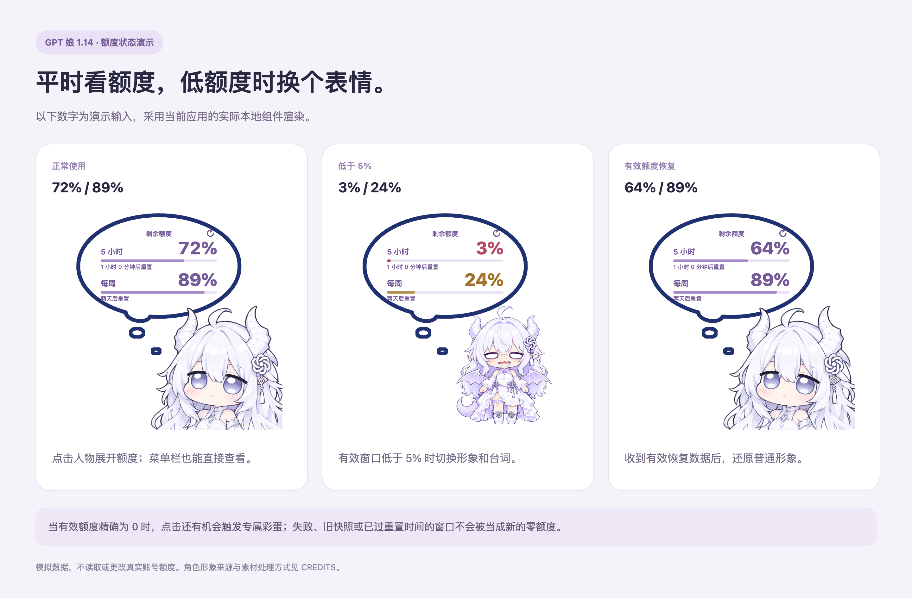
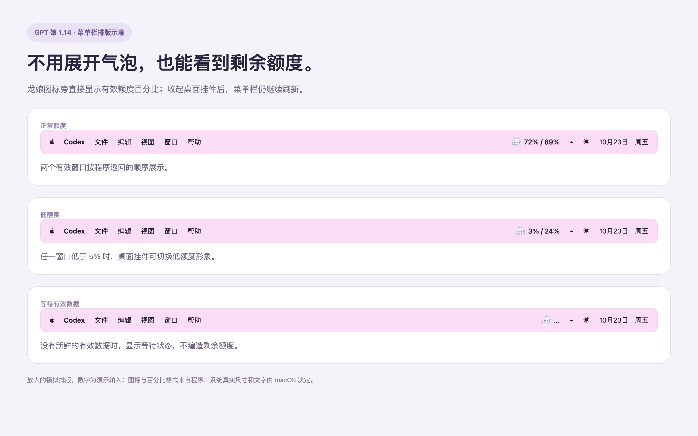
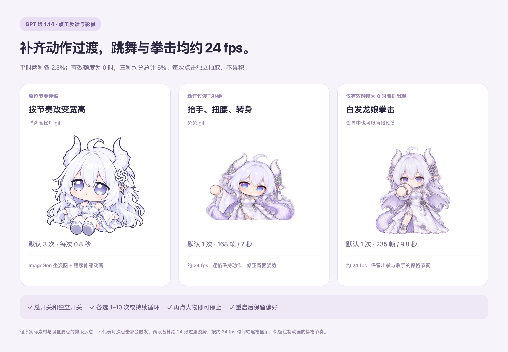
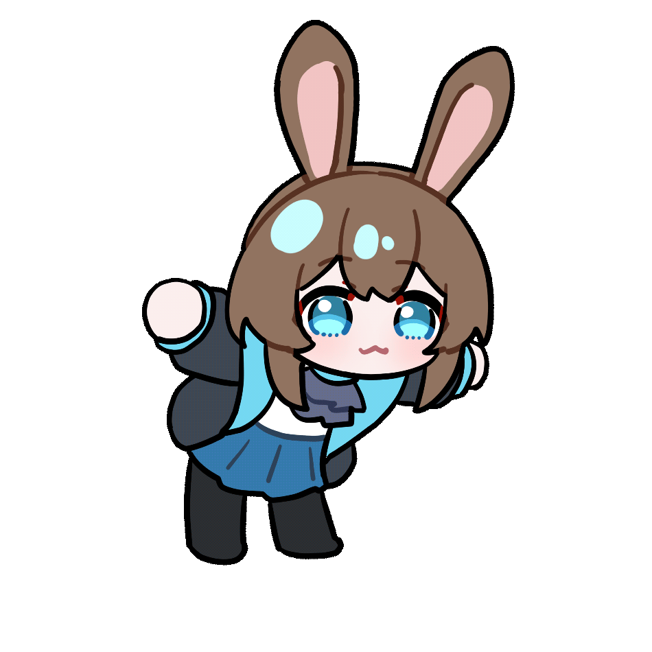
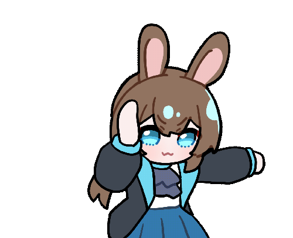
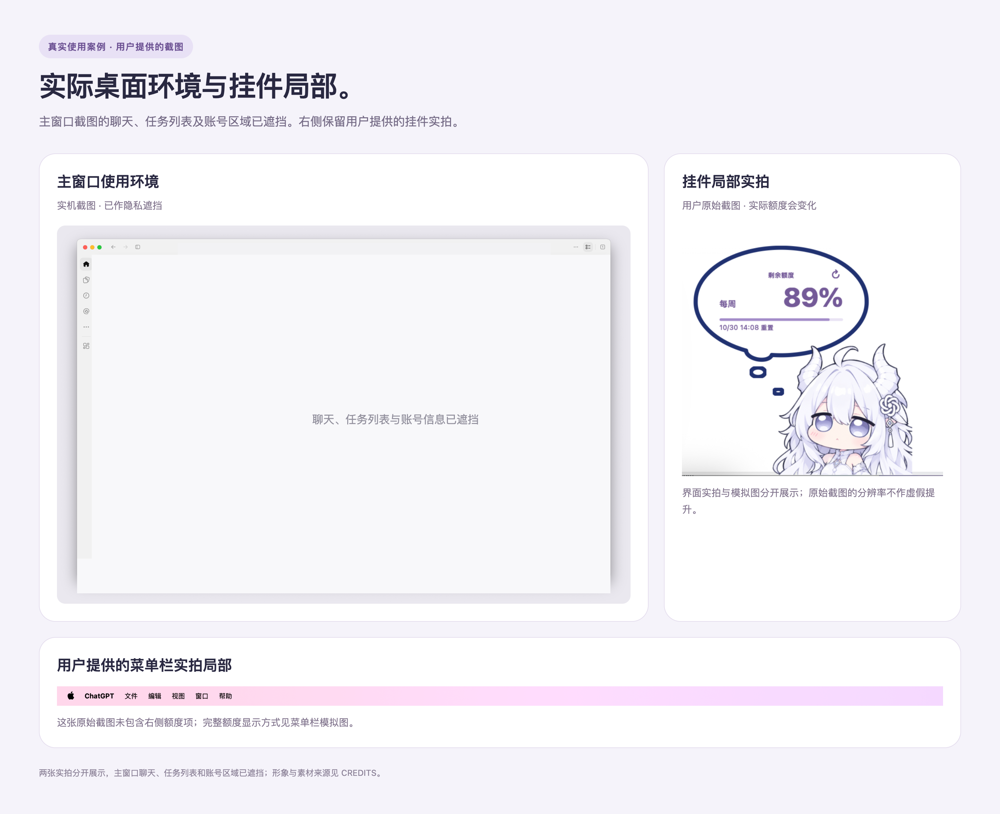

# 小白龙娘 · macOS WebView 改进版 1.14

> 发布准备中：当前仓库为私有预览，安装包保存在 Release 草稿。早期视频片段的用途许可继续记录；本次新动作参考和零额度动图的出处、公开许可仍需确认，由维护者决定公开时机。

本项目是非官方的 Codex 额度挂件，与 OpenAI 无隶属、赞助或背书关系。

基于 [T7moris/GPT-Niang v1.3.5](https://github.com/T7moris/GPT-Niang/tree/v1.3.5) 的 Mac 定制改进版：查看 Codex 剩余额度、桌面龙娘、低额度形象与可设置的点击彩蛋。

[下载安装包](https://github.com/CatGod4456/XiaoBaiLongNiang-Mac/releases/latest) · [更新公告](docs/RELEASE-1.14.md) · [来源与致谢](docs/CREDITS.md) · [上游项目](https://github.com/T7moris/GPT-Niang)

主体应用代码来自 **T7moris/GPT-Niang**，角色形象来源为 **ZipZipPipe**，早期跳舞素材引用 **这个刀子真甜**，当前跳舞按用户提供的另一张 GIF 重绘。本仓库独立创建并保留上游历史，记录的是我在实际 Mac 使用反馈基础上做的细节改进；本次更新使用 **Codex 辅助生成、修改和验证**。



以上是采用实际 Web 组件渲染的高清模拟图，数字为演示数据。更多 [菜单栏、彩蛋与实机案例](docs/SHOWCASE.md)。


## 相比原版改进了什么

原版已有 macOS 应用、额度查询、窗口跟随、菜单栏入口和点击音效。实际使用时，我希望少打开一次气泡、减少小窗口抢占、让人物贴底更自然，也能自己决定彩蛋开关与播放次数。此次更新围绕这些需求展开。

| 项目 | 本改进版的变化 |
| --- | --- |
| 界面与气泡 | 使用本地 WKWebView 展示，调整气泡轮廓、布局和淡紫配色；保留原生设置与额度后台 |
| 菜单栏额度 | 菜单栏直接显示剩余百分比；收起桌面挂件后仍继续刷新，并使用龙娘图标 |
| 窗口跟随 | 优先选择较大的 Codex 主窗口，减少小型预览窗口抢占；修正人物可见底边的对齐 |
| 人物与图标 | 使用用户提供的普通立绘，保留跨中线整体镜像，换用对应的 macOS 应用图标 |
| 低额度状态 | 任一有效额度窗口低于 5% 时切换低额度形象和台词；有效额度恢复后自动还原 |
| 图片自定义 | 普通形象与低额度形象分别导入、恢复默认，低额度台词可编辑 |
| 普通点击动画 | 触摸板轻点也完整压下、回弹；可调 0.5–3 倍速度，或选择立即到达压缩姿态；偏好在重启后保留 |
| 点击彩蛋 | 坐姿节奏伸缩、重绘跳舞和白发龙娘零额度拳击；平时两种各 2.5%，有效额度为 0 时三种均分总计 5%，不累积 |
| 彩蛋控制 | 总开关、独立开关；各选 1–10 次或持续循环；点击人物可停止 |
| 独立资源加载 | 网页与彩蛋优先读取 App 内部资源；移开构建资源后仍通过完整启动检查，无需保留源码目录 |
| 安装 | Apple Silicon 安装包内置经过官方校验的 Node.js，无需另外安装 Node.js |

透明空白区域可穿透点击；气泡收起后，原生窗口会裁到人物范围。桌面显示、跟随模式与原有音量等设置继续保留。

## 动画与效果展示





设置里可以预览三种彩蛋，也可以独立关闭或调整次数。坐姿图片为 AI 根据角色参考生成；当前跳舞以用户提供的 140 帧 GIF 为动作参考，使用 ImageGen 重绘白发龙娘关键帧并补绘 24 张过渡姿势，按时间轴保持绘制姿势、合成为 168 帧、7 秒透明动画；形象图只用于长裙、龙角、发饰和龙尾等设计参考。零额度拳击彩蛋也按用户提供的 98 帧 GIF 动作重绘为白发龙娘，在原 25 张 AI 关键帧之外补绘 24 张过渡姿势，按时间轴保持绘制姿势、合成 235 帧、9.8 秒透明动画。两段均约 24 fps。普通立绘由用户提供并保留原图内容，各类来源分别记录在 [CREDITS](docs/CREDITS.md)。

| 普通轻点 | 坐姿 stretch |
| --- | --- |
|  |  |

| 白发龙娘新跳舞 | 白发龙娘零额度拳击 |
| --- | --- |
|  |  |

[点按音效视频](docs/media/press-sound.mp4) · [伸缩与跳舞 GIF 演示](docs/SHOWCASE.md#设置里的小彩蛋)。GIF 无声，视频使用程序内置音效；画面由实际组件渲染，额度为演示数字。



这组是实机案例，和上面的模拟渲染分开展示；完整原始聊天截图不会随仓库或应用分发。

## 下载与使用

本改进版的发布版本为 **1.14**；应用及后台的三段版本号记为 `1.14.0`。上游源码基线仍为 `v1.3.5`。

当前预编译包适用于 **Apple Silicon（M 系列芯片）、macOS 13.5 或更新版本**。需要已安装并用 ChatGPT 账号登录的 Codex 桌面端。当前发布包不是 Intel 通用包。

1. 从本仓库的 [Releases](https://github.com/CatGod4456/XiaoBaiLongNiang-Mac/releases) 下载 `XiaoBaiLongNiangMac.zip`，解压后把 `XiaoBaiLongNiangMac.app` 放入“应用程序”。
2. 打开应用。可在桌面拖动人物，点击人物查看额度，右键或从菜单栏进入设置。
3. 在“显示与位置”选择桌面模式或跟随 Codex；在“彩蛋”设置启用状态和播放次数。

应用采用本地临时签名，尚未经过 Apple 公证。若 macOS 阻止首次打开，请核对下载来源后，在系统设置的“隐私与安全性”中按系统提示确认。无需关闭系统安全功能。

本改进版不会被上游自动更新覆盖；新版本从本仓库 Releases 获取。当前包沿用上游应用标识和偏好目录，安装前应退出已运行的 小白龙娘；替换同名应用后会继续使用本机已有偏好。

## 彩蛋说明

- **坐姿伸缩**：在原位按节奏改变宽高，以可见脚底为支点。默认 3 次，每次 0.8 秒。
- **跳舞**：替换早期视频抠图版；按用户提供 GIF 的抬手、扭腰、转背和转回顺序重绘。输出 168 帧、7 秒，约 24 fps，默认 1 次。在原关键帧基础上补绘 24 张过渡姿势，按时间轴保持绘制姿势，保留手臂、衣裙、头发和尾巴的逐格变化，修正背面姿势。属于 AI 关键帧重绘与逐格保持，不宣称每帧都是独立手绘。
- **零额度**：仅在当前有效、未过期的额度窗口确实等于 0 时，点击才参与随机触发。按用户提供的拳击 GIF 重绘为白发龙娘，保留长裙、双角、发饰和龙尾；在原关键帧基础上补绘 24 张过渡姿势，按时间轴逐格保持姿势，输出 235 帧、9.8 秒（约 24 fps），默认 1 次；设置内可直接预览。
- 平时伸缩和跳舞各 2.5%；有效额度为 0 时，三种各占 `5% ÷ 3`（约 1.67%），合计最多 5%。每次点击独立抽取，关闭某种不会把概率转给其他种。失败、旧快照、已过重置时间的窗口或四舍五入看起来为 0 的正数，不触发零额度彩蛋。
- 开关和次数在重启后保留；再次点击人物可以停止播放。设置里的预览按钮可直接查看效果。

## 来源与创作者署名

| 类别 | 来源 |
| --- | --- |
| 创意与交互参考 | [MeteorNOX / DeepSeek-Balance-Whale-Widget](https://github.com/MeteorNOX/DeepSeek-Balance-Whale-Widget) |
| 直接源码基础 | [T7moris / GPT-Niang](https://github.com/T7moris/GPT-Niang)，基于 v1.3.5；[上游下载页](https://github.com/T7moris/GPT-Niang/releases) |
| 原生 Mac 移植 | 上游贡献者 [meaqua9420](https://github.com/meaqua9420) 及 [其他贡献者](docs/UPSTREAM-CREDITS.md) |
| 早期跳舞视频素材 | [这个刀子真甜](https://space.bilibili.com/23315338/)：《[大肥鱼一键跟跳](https://www.bilibili.com/video/BV1ovpE66Es8/)》 |
| 形象来源 | [ZipZipPipe](https://space.bilibili.com/4168597/)，按用户提供的形象出处署名 |

普通立绘由用户提供；坐姿彩蛋基于角色参考、通过 ImageGen 制作；早期跳舞 GIF 从上述视频中提取并处理透明背景。当前替换版是基于用户另行提供的 140 帧动作参考重绘；零额度拳击也依据用户另行提供的 GIF 动作参考重绘，出处与许可待确认。原角色设计和视频动作归对应创作者，本改版记录素材来源与处理方式。

本次需求、使用反馈和发布由 CatGod4456 整理；代码修改与验证使用 Codex 辅助完成。更完整的代码关系、素材加工和许可说明见 [CREDITS](docs/CREDITS.md)。

## 关注与感谢

[关注主播](https://space.bilibili.com/319500223/) 谢谢喵

感谢提供源码、早期跳舞素材与角色形象的三位 UP 主：

| UP 主 | B 站 UID | 本项目引用来源 |
| --- | --- | --- |
| [T7moris](https://space.bilibili.com/642488914/) | 642488914 | GPT-Niang 源码作者 |
| [这个刀子真甜](https://space.bilibili.com/23315338/) | 23315338 | 《大肥鱼一键跟跳》跳舞素材 |
| [ZipZipPipe](https://space.bilibili.com/4168597/) | 4168597 | 角色形象来源 |

感谢原作者与开源贡献者。

## 许可

早期跳舞片段已获得视频作者对本项目所述用途的同意；该许可不自动覆盖本次另行提供的新参考与零额度动图，见 [素材许可记录](docs/ASSET-PERMISSIONS.md)。

代码与一般文档保留上游 [MIT License](LICENSE)，以及 [MeteorNOX 上游语录许可](gpt-niang-usage/assets/quotes-LICENSE.txt) 和 [参考代码许可](references/whale-widget-LICENSE.txt)。

**角色图片、图标和视频动画不因代码开源而适用 MIT。** 第三方素材的权利及使用条件仍归原权利人；来源署名不表示获得额外授权。本仓库不授予第三方角色、视频的商业使用或独立素材包分发权。详见 [素材声明](gpt-niang-usage/assets/CHARACTER-NOTICE.txt)。

## 从源码构建

源码构建需要 Node.js 20+、完整 Xcode 和 macOS SDK。运行：

```bash
bash Build-Mac.command
```

构建会执行相关测试，生成并临时签名 `dist/XiaoBaiLongNiangMac.app`，并从 Node.js 官方来源下载和校验对应运行时。普通下载用户不需要 Xcode 或自行构建。

手动构建通用包：

```bash
GPT_NIANG_BUILD_CONFIGURATION=release GPT_NIANG_BUILD_UNIVERSAL=1 bash script/build_and_run.sh --build-only
```

仓库保留上游 Windows 代码作为来源的一部分；本次改进与预编译包面向 macOS。Intel、旧系统、多屏和其他应用全屏切换仍需要更多实机验证，通用构建入口不代表这些环境已完成验证。

## 验证与数据

本次 Mac 改进通过 150 项原生测试和 17 项构建入口 Node 测试，另通过真实浏览器短按完整压缩／回弹与立即压下检查。测试覆盖额度状态、透明区域命中、菜单栏、主窗口选择、彩蛋概率与播放控制；已在一台 Apple Silicon Mac 安装运行。新增控件的完整鼠标验收，以及多屏／全屏组合场景尚未全部完成。

额度沿用上游的本地只读查询，不发起模型生成。WebView 加载本地资源，不接收账号凭证或聊天正文。仓库与下载包不包含本机登录配置、额度快照、聊天截图或个人设置。

本次发布前进行了 [源码与发布包安全／隐私检查](docs/SECURITY-REVIEW.md)：修除编译路径信息，排除登录数据、个人设置及原始聊天截图；在检查范围内未发现明确的后门行为。此结果不是独立安全认证。
